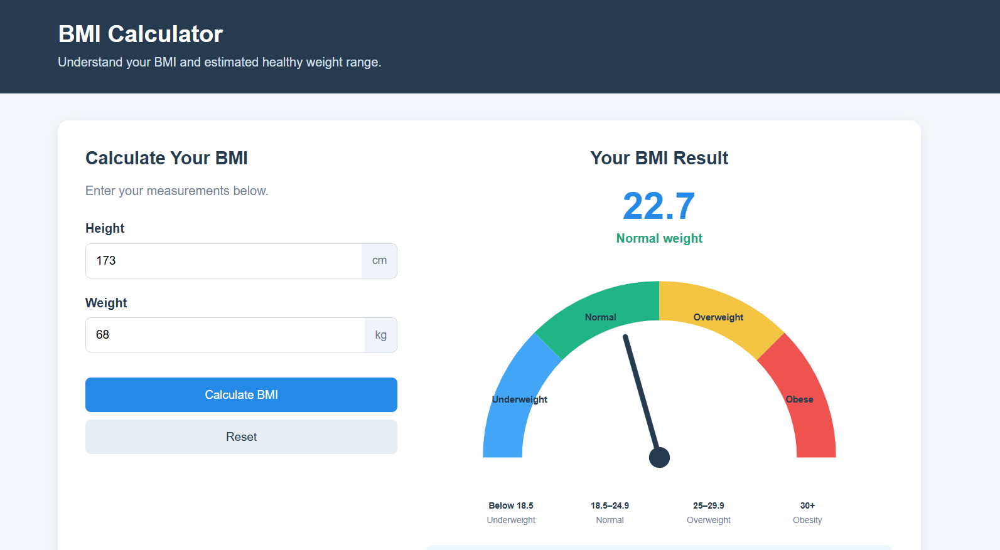

# BMI Calculator

A simple BMI Calculator built with Python, HTML, CSS and JavaScript. This project allows users to calculate their Body Mass Index (BMI), understand their BMI category and view an estimated healthy weight range.

## Features

- Calculate BMI using height and weight.
- Display the calculated BMI value.
- Identify the BMI category.
- Display the estimated healthy weight range.
- Provide a basic health interpretation of the result.
- Validate user inputs and display error messages.
- Responsive website layout for desktop and mobile devices.

## BMI Formula

BMI is calculated using the following formula:

**BMI = Weight (kg) / Height (m)²**

For example:

- Weight: 70 kg
- Height: 1.75 m

BMI = 70 / (1.75 × 1.75) = 22.86

## BMI Categories

| BMI Range | Category |
|---|---|
| Below 18.5 | Underweight |
| 18.5 – 24.9 | Normal weight |
| 25.0 – 29.9 | Overweight |
| 30.0 and above | Obesity |

These are standard adult BMI reference categories.

## Estimated Healthy Weight Range

The calculator estimates a healthy weight range using the adult BMI reference range of 18.5 to 24.9.

The calculation uses the user's height to estimate the corresponding weight range.

## Technologies Used

- Python
- HTML5
- CSS3
- JavaScript

## Project Structure

```text
Body-Mass-Index-Calculator/
│
├── bmi_calculator.py
│
├── website/
│   ├── index.html
│   ├── style.css
│   └── script.js
│
└── README.md
```

## Running the Project

### Python CLI Version

1. Clone the repository.
2. Open the project folder in your terminal.
3. Run:

```bash
python bmi_calculator.py
```

### Website Version

1. Open the project folder.
2. Navigate to the `website` folder.
3. Open `index.html` in your browser.

## Important BMI Limitations

BMI is a screening tool and does not diagnose health conditions. It should be interpreted alongside other health indicators.

### Pregnancy

BMI is highly inaccurate during pregnancy because pregnancy-related weight changes make standard BMI calculations unreliable.

### Bodybuilders and Muscular Individuals

BMI can be highly inaccurate for bodybuilders because it does not distinguish muscle mass from body fat. This can result in muscular individuals being classified as overweight or obese.


## Preview


